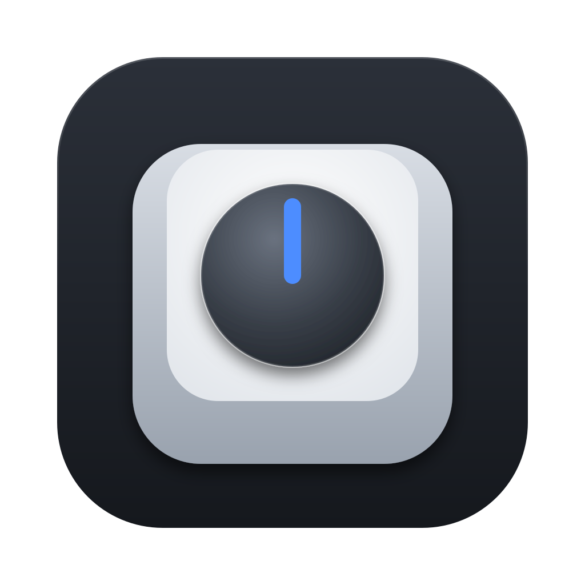
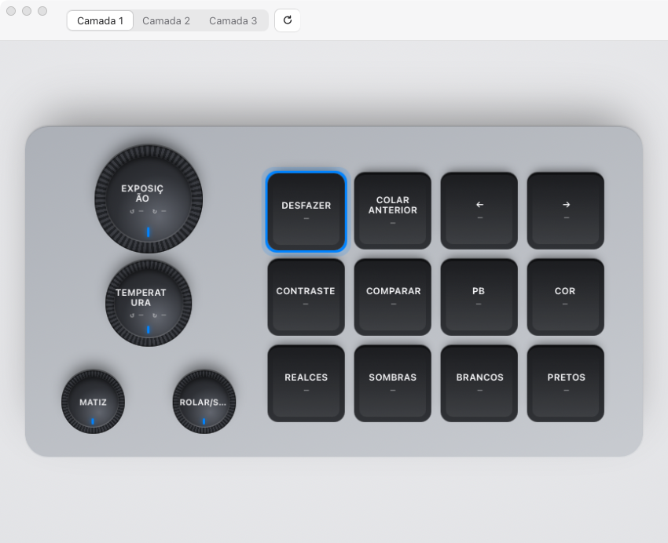

<div align="center">



# Padturn

**Seu mini teclado de knobs merecia um app melhor.**

Configure cada tecla, cada knob e cada luz do seu macro pad de 12 teclas e 4 knobs
num app bonito, em português, que mostra o teclado de verdade na tela.

[](https://github.com/eacarva/padturn/releases/latest)
[](https://github.com/eacarva/padturn/releases/latest)

[](https://github.com/eacarva/padturn/releases/latest)
[](https://github.com/eacarva/padturn/releases)
[](https://github.com/eacarva/padturn/actions)
[](https://ko-fi.com/elissonandrade)

<br>



</div>

## Por que o Padturn?

Aqueles mini teclados baratos de 12 teclas e knobs são ótimos no Lightroom, no Photoshop, na edição
de vídeo e em lives. O problema é o app que vem com eles: feio, confuso, em inglês ruim, e só
mostra números onde deveria mostrar o seu teclado.

O Padturn faz o mesmo trabalho do jeito que devia ser:

- 🎛️ **Você vê o seu teclado.** Teclas e knobs desenhados como são, girados do jeito que você usa (até de cabeça para baixo).
- ⌨️ **Aperte para configurar.** Clique numa tecla do desenho e aperte o atalho no seu teclado. Pronto.
- 💡 **Toque e veja acender.** Aperte uma tecla física e ela acende no desenho. Nunca mais "qual era essa mesmo?".
- 🌀 **Knobs completos.** Girar para a esquerda, apertar e girar para a direita, cada um com sua ação.
- 🎵 **Mídia, mouse e macros.** Volume, play/pause, cliques, rolagem, gestos e sequências de teclas com atraso.
- 🌈 **Luzes.** Modo de luz de cada camada e cor de cada tecla.
- 📚 **3 camadas.** Três conjuntos de atalhos no mesmo teclado.
- 🛟 **Sem medo de errar.** Backup automático antes de cada gravação, desfazer, exportar e restaurar.
- 🖥️ **Mac e Windows.** Um app pequeno e nativo, feito com Tauri.

## Como funciona

1. **Conecte** o teclado pelo cabo USB (pelo Bluetooth ele digita, mas não aceita configuração).
2. **Clique em Ler.** O Padturn encontra o teclado sozinho e mostra o que está gravado.
3. **Mude** o que quiser e clique em **Gravar**. A configuração fica no próprio teclado, então funciona em qualquer computador, mesmo sem o Padturn aberto.

> Feche o app MINI_KEYBOARD do fabricante antes: ele prende o teclado e nenhum outro programa consegue configurar.

## Instalação

Baixe a última versão em **[Releases](https://github.com/eacarva/padturn/releases/latest)**.

<details>
<summary><b>macOS</b> (Apple Silicon e Intel): <code>Padturn_x.y.z_universal.dmg</code></summary>

1. Abra o `.dmg` e arraste o Padturn para Aplicativos.
2. O app ainda não tem assinatura da Apple, então o macOS bloqueia a primeira abertura. Para liberar:
   abra **Ajustes do Sistema → Privacidade e Segurança**, role até o aviso do Padturn e clique em **Abrir Mesmo Assim**.
   Ou, no Terminal:

   ```bash
   xattr -dr com.apple.quarantine /Applications/Padturn.app
   ```

</details>

<details>
<summary><b>Windows</b> 10 e 11: <code>Padturn_x.y.z_x64-setup.exe</code></summary>

1. Rode o instalador.
2. Se o SmartScreen avisar "O Windows protegeu o computador", clique em **Mais informações → Executar assim mesmo**. O aviso aparece porque o app ainda não tem certificado de assinatura.

O Windows ainda está em teste: se algo não funcionar, [abra uma issue](https://github.com/eacarva/padturn/issues).

</details>

## Compatibilidade

| Teclado | Situação |
|---|---|
| 12 teclas + 4 knobs (USB `514C:8850`) | ✅ Testado no hardware: teclas, knobs, mídia, mouse, macros e luzes |
| Outros modelos `514C` (3 a 21 teclas, 0 a 4 knobs) | 🧪 Devem funcionar; o desenho é calculado e pode sair diferente do físico |
| Modelos `1189` e firmware antigo | ❌ Usam outro protocolo; o Padturn avisa e não grava |

Tem outro modelo? [Abra uma issue](https://github.com/eacarva/padturn/issues) com uma foto. Isso ajuda a acertar o desenho.

## Perguntas frequentes

**É grátis?**
Sim. Ao abrir, ao ler e ao gravar aparece um convite para apoiar, que você pode fechar e seguir usando tudo.
Com um apoio de US$ 5 ou mais no Ko-fi você recebe uma chave por e-mail e o convite some para sempre.

**Preciso deixar o Padturn aberto?**
Não. A configuração é gravada no teclado.

**Posso perder a configuração atual?**
Antes de cada gravação o Padturn salva um backup automático, e você pode restaurar quando quiser.

**Funciona no Linux?**
Ainda não há instalador para Linux, mas o código é o mesmo. Contribuições são bem-vindas.

## Apoie

O Padturn é feito por uma pessoa só, nas horas vagas. Se ele te poupou tempo, considere
[apoiar no Ko-fi](https://ko-fi.com/elissonandrade). Além de tirar o convite do app, isso paga o café das próximas versões. ☕

## Compilar a partir do código

Precisa de [Node.js](https://nodejs.org) 20+ e [Rust](https://rustup.rs).

```bash
git clone https://github.com/eacarva/padturn.git
cd padturn
npm install
npm run dev      # abre o app em modo de desenvolvimento
npm test         # testes
npm run build    # gera o instalador da sua plataforma
```

O protocolo do teclado, levantado por engenharia reversa, está documentado em [ESPECIFICACAO.md](ESPECIFICACAO.md).

## Licença

[PolyForm Shield 1.0.0](LICENSE.md): use, estude e modifique à vontade, inclusive no trabalho.
Só não pode usar o código para fazer um produto concorrente, como revender o Padturn.

<div align="center"><sub>Feito no Brasil por <a href="https://elissonandrade.com.br">Elisson Andrade</a>.</sub></div>
